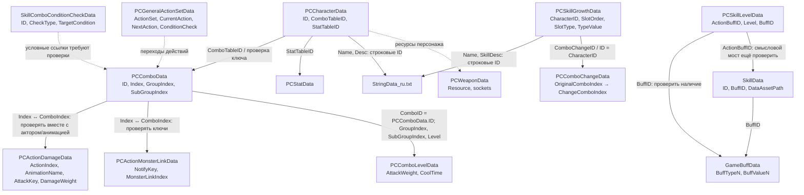

# DragonSword: Awakening — анализ игровых таблиц

Репозиторий содержит извлечённые из игровых данных XML-таблицы, русские строки локализации и инвентарные списки доступных таблиц. Цель анализа — восстановить каталог персонажей и навыков, классификацию действий, переходы комбо, параметры ударов и связи с эффектами.

> **Статус документа:** схема построена по фактическим именам полей и примерам записей доступных таблиц. Там, где связь между таблицами ещё не доказана общим ключом, она помечена как гипотеза/требующая проверки. Числа `AttackWeight` и `DamageWeight` не следует автоматически считать процентами от ATK.

> **Навигация:** **README** (таблицы и схема связей) · [Анализ боевой системы](COMBAT_DATA_ANALYSIS.md) · [Формулы урона](damage-research/DAMAGE_FORMULA.md) · [Перепроверка damage-research](damage-research/VERIFICATION.md) · Разборы героев: [ Вероника](Veronica/VERONICA_SKILLS.md) · [ Жером](Jerome/JEROME_SKILLS.md) · [ Логан](Logan/LOGAN_SKILLS.md)

## Содержание

- [Документы репозитория](#документы-репозитория)
- [Состав репозитория](#состав-репозитория)
- [Что описывает каждый файл](#что-описывает-каждый-файл)
- [Схема связей](#схема-связей)
- [Ключевые поля](#ключевые-поля)
- [Как восстанавливать навыки и урон](#как-восстанавливать-навыки-и-урон)
- [Ограничения и следующие шаги](#ограничения-и-следующие-шаги)

## Документы репозитория

| Документ | О чём |
|---|---|
| [README.md](README.md) | Описание таблиц, ключевых полей и схема связей (этот файл). |
| [COMBAT_DATA_ANALYSIS.md](COMBAT_DATA_ANALYSIS.md) | Анализ боевой системы: как читать `PCComboData`, `PCActionDamageData`, `PCComboLevelData`, `PCComboChangeData`, что подтверждено и что нет. |
| [Veronica/VERONICA_SKILLS.md](Veronica/VERONICA_SKILLS.md) | Разбор навыков Вероники (`CharacterID=10019`). |
| [Jerome/JEROME_SKILLS.md](Jerome/JEROME_SKILLS.md) | Разбор навыков Жерома (`CharacterID=10015`). |
| [Logan/LOGAN_SKILLS.md](Logan/LOGAN_SKILLS.md) | Разбор навыков Логана (`CharacterID=10033`). |
| [damage-research/DAMAGE_FORMULA.md](damage-research/DAMAGE_FORMULA.md) | Формулы урона: до наложения статусов, после наложения, коэффициенты статусов, реакции стихий. Каждое звено помечено статусом доказательности. |
| [damage-research/VERIFICATION.md](damage-research/VERIFICATION.md) | Перепроверка стороннего ресёрча по таблицам репозитория: что подтверждено, опровергнуто, не проверяется. |
| [damage-research/BOSSES_EXTENDED.csv](damage-research/BOSSES_EXTENDED.csv) | Боссы Усмирения (36 строк оригинала без изменений) и рейдов Гаурона и Урсулы (18 строк) с данными `MonsterStatData`: суперармор, множители урона по статусам, срез брони, пороги накопления. |
| [damage-research/](damage-research/) и [game-data/](game-data/) | Сторонний ресёрч и файлы-источники (`MonsterStatData.xml`, `MesmerizedData.xml`, блюпринт манекена и др.). |

Файлы героев строятся по одному шаблону: навыки и локализация → записи `PCComboData` → эффекты и условия → структура ударов → что не соединено → что подтверждено.

## Состав репозитория

### Инвентарные файлы

| Файл | Назначение |
|---|---|
| `Xml_list.txt` | Список путей к XML, извлечённым из `DS/Content/__GeneratedGameData__/Server/XML/GameData/`. Это **инвентарь путей**, а не содержимое самих таблиц. |
| `table_list.txt` | Список путей к `.table` из `DS/Content/Design/GameData/`. Также инвентарь, а не сами данные. |
| `StringData_ru.txt` | Экспорт русских локализованных строк в JSON-подобном формате. Несмотря на расширение `.txt`, файл нужно читать как JSON. |

### Таблицы персонажей, навыков и боевой системы

| Файл | Назначение и полезные поля | Степень подтверждения |
|---|---|---|
| `PCCharacterData.xml` | Основная запись персонажа: `ID`, `Name`, `Desc`, `BluePrint`, `AnimInst`, `ComboTableID`, `StatTableID`, `PassiveActionBuffList`, `ActiveActionBuffList`, тип базовой атаки и другие настройки. | Подтверждено по полям таблицы. |
| `PCCharacterLevelData.xml` | Уровневые параметры персонажей и опыт/прогрессия. Использовать вместе с `PCCharacterData.xml`; точные поля нужно читать из схемы конкретной версии. | Назначение следует из имени; поля требуют проверки. |
| `PCCharacterAscendData.xml` | Данные возвышения персонажа. Нужны для оценки изменений характеристик и разблокировок на этапах прогрессии. | Назначение следует из имени; поля требуют проверки. |
| `PCCharacterTranscendData.xml` | Данные трансценденции. Важно для вариантов навыков/комбо, доступных при разных значениях `Transcend`. | Назначение следует из имени; поля требуют проверки. |
| `PCSkillGrowthData.xml` | Каталог прокачиваемых слотов навыков. Подтверждённые поля: `ID`, `CharacterID`, `TypeValue`, `SlotLevel`, `ComboChangeID`, `SkllType`, `SlotOrder`, `SlotType`, `Name`, `SkillDesc` и ссылки на материалы прокачки. | Подтверждено по полям таблицы. |
| `PCSkillLevelData.xml` | Параметры уровней эффектов/действий: `ActionBuffID`, `Level`, `Desc`, `Duplication`, `Duration`, `CoolTime`, `BuffID`, `StringVarArr`. `ActionBuffID` не следует считать ID навыка без дополнительной связи. | Подтверждено по полям таблицы. |
| `PCComboData.xml` | Каталог комбо-действий персонажей. Поля включают `ID`, `Index`, `Desc_Character`, `Desc_Combo`, `GroupIndex`, `SubGroupIndex`, `ActionBuffList`, `OpenCondition`, `CoolTime`, `InitCoolTime`, `CoolTimeShare`, `MaxFury`, `FuryStack`, `TargetCondition`, `ActiveCondition`, `AttackWeight`, `HitFury`, `HitAggro`, `SuperArmorBreak`. | Подтверждено по полям таблицы. |
| `PCComboLevelData.xml` | Уровневые параметры комбо: `ComboID`, `GroupIndex`, `SubGroupIndex`, `Level`, `ActionBuffList`, `ActionBuffLevel`, `CoolTime`, `AttackWeight`, `HitFury`, `HitAggro`, `SuperArmorBreak`. Используется для проверки, как параметры меняются с уровнем. | Подтверждено по полям таблицы. |
| `PCComboChangeData.xml` | Таблица замены комбо в зависимости от условий прогрессии. Поля `KarmaID`, `Master`, `Transcend`, `OriginalComboIndex`, `ChangeComboIndex`, `ChangeAnimSet` описывают исходные и заменяющие индексы. Списки индексов разделены `#`; элементы следует сопоставлять попарно по позиции. | Подтверждено по полям таблицы и формату примеров. |
| `PCActionDamageData.xml` | Привязка боевых действий/анимаций к параметрам ударов. Подтверждённые поля: `ID`, `Name`, `Type`, `ActionIndex`, `AnimationName`, `AttackKey`, `ComboIndex`, `DamageWeight`, `SuperArmorWeight`, `FixedSuperArmorValue`, `FuryWeight`, `MesmerizedParamList`, `HitGroupIndex`. | Подтверждено по полям таблицы. |
| `PCActionMonsterLinkData.xml` | Связи анимационных действий с событиями взаимодействия/захвата цели. Поля включают `ID`, `Name`, `ActionIndex`, `AnimationName`, `NotifyKey`, `ComboIndex`, `MonsterLinkIndex`. Полезно для действий с несколькими notify/hit-событиями и захватов. | Подтверждено по полям таблицы. |
| `PCGeneralActionSetData.xml` | Общая машина переходов действий. Поля `ActionSet`, `ComboIndex`, `ActionIndex`, `CurrentAction`, `NextAction`, `ChangeActionSet`, `AnimationIndex`, `AnimationTag`, `ConditionCheck1..5`, `ConditionValue1..5` описывают действия и условия перехода. Важно для общих действий, но само по себе не является полной таблицей ввода/управления. | Подтверждено по полям таблицы. |
| `PCStatData.xml` | Боевые параметры/сопротивления, в том числе `HP`, `Attack`, `Defence`, критические параметры, скорость, суперброня, сопротивления/длительности состояний. Примеры могут иметь нулевые HP/Attack/Defence, поскольку таблица содержит базовые поправки/сопротивления, а не обязательно итоговые статы персонажа. | Подтверждено по полям таблицы. |
| `PCWeaponData.xml` | Привязка ID оружия к ресурсам и точкам крепления: `ID`, `Resource`, `DefaultSocket`, `CombatSocket`, `HitDirectionID`. Полезна для определения ресурсов оружия и анимационно-боевого контекста, но не является таблицей коэффициентов урона. | Подтверждено по полям таблицы. |
| `SkillData.xml` | Общая таблица игровых навыков/эффектов. Поля включают `ID`, `Type`, `GroupID`, `TargetCondition`, `ActiveCondition`, `EndCondition`, `Duration`, `CoolTime`, `BuffID`, `DataAssetPath`, `WeaponChangeValue`. `DataAssetPath` может указывать на дополнительные параметры в DataAsset/Blueprint. | Подтверждено по полям таблицы. |
| `SkillComboConditionCheckData.xml` | Справочник проверок условий: `ID`, `Desc_Name`, `CheckType`, `TeamCheck`, `AccountCheck`, `GameObjectType`, `ApplyTargetCount`, `MinRange`, `MaxRange` и до четырёх пар типов/значений условий. Использовать для расшифровки числовых `TargetCondition` и других проверок, если ID совпадают. | Подтверждено по полям таблицы; конкретные ссылки проверять по ключам. |
| `GameBuffData.xml` | Эффекты баффов/дебаффов: `ID`, `Desc_Buff`, наборы `BuffTypeN`, `BuffValueN`, `BuffCategoryN`. Примеры показывают неуязвимость, изменение скорости действий, восстановление ярости/выносливости, лечение и добавление характеристик. | Подтверждено по полям таблицы. |

> Если в текущей ветке добавлены другие XML/TXT, их нужно внести в таблицу выше после проверки самих полей. `Xml_list.txt` и `table_list.txt` перечисляют множество файлов игры, но наличие имени в инвентаре само по себе не означает, что содержимое этой таблицы закоммичено в репозиторий.

## Что описывает каждый файл

### 1. `PCCharacterData.xml` — карточка персонажа

Основной ключ записи — `ID` (в примерах это ID боевого объекта/персонажа). Поля `ComboTableID` и `StatTableID` задают ссылки на соответствующие таблицы. `BluePrint` и `AnimInst` указывают на ресурсы логики/анимаций Unreal Engine. `ActiveActionBuffList` и `PassiveActionBuffList` — списки ID, разделённые `#`; их нельзя автоматически трактовать как список пользовательских навыков, пока не установлено, какая таблица использует каждый ID.

### 2. `PCSkillGrowthData.xml` — навыки в интерфейсе прокачки

Записи могут повторяться для разных `SlotLevel`. Поэтому для получения уникального навыка группировать следует не только по `ID`: проверять комбинацию `CharacterID`, `SlotOrder`, `SlotType`, `TypeValue`, `Name`, `SkillDesc` и уровня. `Name` и `SkillDesc` — строковые ID, которые разрешаются через `StringData_ru.txt` (ключ ID → `SourceString`).

Поле `ComboChangeID` указывает на потенциальную связь с заменой комбо, но конкретную семантику необходимо проверять по значениям `PCComboChangeData.ID` и записям персонажа. Не следует считать `TypeValue` универсальным перечислением для всех таблиц без проверки.

### 3. `PCComboData.xml` и `PCComboLevelData.xml` — комбо и их уровни

`PCComboData.ID` идентифицирует группу/персонажа в этой таблице; `Index` — индекс конкретного варианта действия. Например, у Джерома (`ID=1000013`) присутствуют записи для уклонения (`Index=701`), прыжка (`801`), атаки после уклонения (`901`), дополнительного ввода после неё (`902`), атаки после рывка (`915`) и вариантов сигнального/активного навыка.

Не путать:
- `ID` — владелец/группа комбо в `PCComboData`;
- `Index` — индекс конкретного комбо-действия;
- `ComboID` в `PCComboLevelData` — это `PCComboData.ID` (подтверждено для всех 27 значений). Уровневые строки соединяются по `ComboID` + `GroupIndex` + `SubGroupIndex`, `Level` задаёт уровень слота.

`AttackWeight` из `PCComboData`/`PCComboLevelData` — боевой параметр комбо. Не доказано, что он является тем же самым, что `DamageWeight` из `PCActionDamageData`, или что любое из этих значений является непосредственным множителем ATK.

### 4. `PCActionDamageData.xml` — события удара в анимации

Одна анимация может иметь несколько строк из-за разных `AttackKey` или нескольких hit-событий. Для анализа удара сохранять как минимум кортеж:

`Name + ActionIndex + AnimationName + ComboIndex + AttackKey + HitGroupIndex`

`DamageWeight` описывает вес/долю события в системе урона, но точная формула перевода этого поля в числовой урон требует подтверждения. Нельзя просто сложить все строки по `ComboIndex`, не проверив дубликаты, `AttackKey` и принадлежность конкретному персонажу/анимации.

### 5. `PCActionMonsterLinkData.xml` — события взаимодействия с целью

`ActionIndex` и `AnimationName` связывают запись с конкретным действием/анимацией; `NotifyKey` может отличать события внутри анимации, а `MonsterLinkIndex` — выбирать вариант взаимодействия. Эти записи нужны прежде всего для захватов, multi-mount и действий, где урон/захват возникает через анимационные notify.

### 6. `PCComboChangeData.xml` — замена вариантов комбо

`OriginalComboIndex` и `ChangeComboIndex` — последовательности, разделённые `#`. Внутри одной записи их следует разбивать и сопоставлять попарно по позиции, а не сортировать независимо. `ID` записи равен `CharacterID` героя; строки есть не у всех героев. Для одного героя набор строк — это комбинации `Master` (True/False), `Transcend` (0/1/3/6) и `KarmaID` (0 или ID кармы): чем выше `Transcend`, тем больше пар. Фильтры определяют вариант прогрессии.

### 7. `SkillData.xml`, `PCSkillLevelData.xml`, `GameBuffData.xml` — эффекты

Это разные уровни модели:
- `SkillData.ID` — определение навыка/эффекта, с типом, целями и длительностью;
- `PCSkillLevelData.ActionBuffID` — уровень параметров действия/баффа;
- `PCSkillLevelData.BuffID` — ссылка на эффект баффа, которую следует проверять в `GameBuffData.ID`;
- `GameBuffData.BuffTypeN` и `BuffValueN` — конкретные эффекты и значения.

Эти связи нельзя сливать в одну таблицу только по совпадению названий. Нужны проверка ключей и цепочка ID.

### 8. `PCStatData.xml` и `PCWeaponData.xml`

`PCStatData` описывает наборы боевых параметров и сопротивлений. `PCCharacterData.StatTableID` — кандидат на ссылку к `PCStatData.ID`, подтверждаемый совпадением значений ID в примерах. `PCWeaponData` описывает оружейные ресурсы/сокеты; прямого коэффициента урона в показанных полях нет.

### 9. `StringData_ru.txt`

Файл содержит объект `Data`, где ключ — строковое представление ID, а запись содержит `ID` и `SourceString`. Сопоставлять `PCSkillGrowthData.Name`, `SkillDesc`, `PCCharacterData.Name`/`Desc` с локализацией следует как `int/string ID → Data[ID].SourceString`. При анализе не заменять отсутствующий перевод догадкой: сохранять исходный ID и помечать строку как неразрешённую.

## Схема связей

### Надёжность связей

| Связь | Статус | Примечание |
|---|---|---|
| `PCCharacterData.Name/Desc` и `PCSkillGrowthData.Name/SkillDesc` → `StringData_ru.txt` | Подтверждена форматом строковых ID | Ключ строки сопоставляется с ID. |
| `PCCharacterData.StatTableID` → `PCStatData.ID` | Подтверждена: найдено 106 из 106 | — |
| `StatDefaultData.ID` (боссы) | Подтверждена: `30001–30056` Усмирение, `40000–40027` рейды Гаурона и Урсулы, `20001–20012` мировые боссы, `90000–90003` тестовые мобы. Числовые поля 36 боссов Усмирения из `damage-research` совпали с таблицей (252 из 252) | — |
| `MonsterStatData.ID` ↔ `StatDefaultData.ID` (боссы) | Соответствие по названию и сложности в `Memo`: Усмирение `90N01BB` (N = сложность − 1, BB = номер босса: 02 Фуркас, 03 Банак, 04 Бардук, 05 Галор, 06 Гуль, 07 Землянин); рейды `914101/03/04` (Огр-мясник), `919101–06` (Гаурон), `922012–15` и `923011–16` (Урсула) | У рейдов соответствие «драконья форма 2» → запись «вершина» выведено по порядку. HP/ATK/DEF в `MonsterStatData` нулевые, они берутся из `StatDefaultData`. |
| `MonsterStatData.*Mes_Attacked_Dmg_Per` | Прибавка к урону по цели в статусе: у обычных монстров контроль 1, стихии 0.5; у «балансных тестовых» 0; у боссов другие значения (см. [DAMAGE_FORMULA.md](damage-research/DAMAGE_FORMULA.md)) | Читается как `1 + значение`. Сочетание нескольких статусов не установлено. |
| `PCCharacterData.ComboTableID` → `PCComboData.ID` | Подтверждена: найдено 106 из 106 | `PCComboData.ID` — это `ComboTableID`, а не `CharacterID`. |
| `PCComboData.Index` ↔ `PCActionDamageData.ComboIndex` | Подтверждена при ключе `Name` (= имя blueprint из `PCCharacterData.BluePrint`) + `ID` (= `CharacterID`) | Для 39 пользовательских героев `ComboIndex` не найден в `PCComboData` у 127 из 2493 строк (напр. `3003` вместо `30030` у Жерома, `0` у Логана). Строки с `ID=2000xxx` — копии «пробных» персонажей, их надо исключать. |
| `PCComboData.Index` ↔ `PCActionMonsterLinkData.ComboIndex` | Сильный кандидат на связь | Аналогично проверять по персонажу/действию и notify. |
| `PCComboChangeData.OriginalComboIndex` → `ChangeComboIndex` | Подтверждена внутри таблицы; позиционное сопоставление проверено на Калиен и Кассиусе (напр. `401 → 9010` «3 трансц.») | Списки позиционные; нужен контекст `KarmaID`, `Master`, `Transcend`. |
| `PCComboChangeData.ID` = `CharacterID` | Подтверждена: все 19 ID таблицы — ID героев | Строки есть не у всех героев: нет у Жерома, Вероники, Логана, Исеры, Отелло, Шарлотты, Райзы. |
| `PCSkillGrowthData.ComboChangeID` → `PCComboChangeData.ID` | Подтверждена частично: ненулевое значение всегда равно `CharacterID` | У Виолы, Даны, Калиен и Лампи строки в `PCComboChangeData` есть, а `ComboChangeID=0`; у Исеры `ComboChangeID` ссылается на ID без строк. Надёжнее связывать по `PCComboChangeData.ID` = `CharacterID`. |
| `PCSkillLevelData.BuffID` → `GameBuffData.ID` | Подтверждена: найдено 434 из 444 ненулевых значений | 10 значений не найдены. |
| `PCSkillLevelData.ActionBuffID` ↔ `SkillData.ID` | ID совпадают: 46 из 47 | Смысловую связь проверять отдельно. Для боевых эффектов героев `PCSkillLevelData` часто строк не содержит — они лежат только в `SkillData`. |
| `PCComboData.ActionBuffList` → `SkillData.ID` → `GameBuffData.ID` | Подтверждена на Веронике, Жероме, Логане (все ID найдены); `SkillData.BuffID` → `GameBuffData.ID` — 804 из 804 | Для `BuffID` вида `a#b` проверять каждый элемент. |
| `PCComboData.TargetCondition` → `SkillComboConditionCheckData.ID` | Подтверждена на Веронике, Жероме, Логане | `Desc_Name` условий читается напрямую; у части условий в названии стоит имя героя. |
| `PCComboLevelData.ComboID` = `PCComboData.ID` | Подтверждена: все 27 значений `ComboID` присутствуют в `PCComboData.ID` | У Вероники, Жерома и Логана `AttackWeight` в этой таблице равен 1 на всех уровнях — рост урона по уровням здесь не хранится. |
| `PCComboData.AttackWeight` ↔ `PCActionDamageData.DamageWeight` | Не эквивалентны по одному лишь имени | Нужны измерения/формула либо дополнительная таблица/логика Blueprint. |

## Ключевые поля

| Поле | Интерпретация |
|---|---|
| `CharacterID` | ID персонажа. В `PCSkillGrowthData` совпадает с `PCCharacterData.ID` (26 из 26); `PCComboData.ID` — это `ComboTableID`, а не `CharacterID`. Один герой может иметь служебные копии (`1509`, `2000018` и т.п. для Вероники) с теми же `ComboTableID` и blueprint — для разбора брать запись с `IsUserCharacter=true`. |
| `TypeValue`, `SlotType`, `SlotOrder`, `SkllType` | Классификация/расположение навыка в системе прокачки. Значения нужно описывать как наблюдаемые enum-коды; не приписывать универсальные значения без проверки всех строк. |
| `Index` | Индекс комбо-действия в `PCComboData`; например, у Джерома `701` — dodge, `801` — jump, `901` — dodge attack, `902` — дополнительный ввод после dodge attack, `915` — dash attack. |
| `GroupIndex`, `SubGroupIndex` | Группировка действий и вариантов комбо; полезны для уровневых/вариантных строк, но не гарантируют уникальность записи сами по себе. |
| `ComboIndex` | Индекс комбо в таблицах анимационных действий; связывать с `PCComboData.Index` только с дополнительной проверкой контекста. |
| `ActionIndex` | Идентификатор действия/анимационного action; полезен для группировки строк урона и событий взаимодействия. |
| `AttackKey` | Идентификатор конкретного attack/hit-события в `PCActionDamageData`; разные ключи могут относиться к одной анимации. |
| `DamageWeight` | Вес события урона; не доказанный прямой процент от ATK. |
| `AttackWeight` | Вес/параметр атаки комбо; не считать синонимом `DamageWeight`. |
| `ActionBuffList`, `ActiveActionBuffList`, `PassiveActionBuffList` | Списки ID, разделённые `#`; для каждого ID необходимо определить таблицу-владелец. |
| `TargetCondition`, `ActiveCondition`, `OpenCondition` | Условия цели, активации и открытия. Пустые значения и числовые значения требуют раздельной интерпретации. |
| `StringVarArr` | Массив параметров в строке, разделённой `#`; семантика зависит от связанного навыка/описания, не универсальна. |

## Как восстанавливать навыки и урон

Для каждой записи создаётся нормализованная строка результата со следующими полями:

1. `character_id` и подтверждённое имя персонажа;
2. тип действия: обычная атака / прыжок / воздушная атака / уклонение / атака после уклонения / атака после рывка / активный / сигнальный / дополнительный вариант;
3. `PCComboData.ID`, `Index`, `GroupIndex`, `SubGroupIndex`;
4. отображаемое имя/описание из локализации, если доступно;
5. условия `OpenCondition`, `TargetCondition`, `ActiveCondition`, `IconActivateConditionType`;
6. `CoolTime`, `InitCoolTime`, `CoolTimeStack`, `CoolTimeShare`;
7. параметры `AttackWeight`, `HitFury`, `HitAggro`, `SuperArmorBreak`;
8. соответствующие `ActionIndex`, `AnimationName`, `AttackKey`, `DamageWeight`;
9. эффекты из `ActionBuffList`/`BuffID` после разрешения ID;
10. статус каждого join: подтверждён / вероятен / не разрешён.

### Порядок анализа

1. Разрешить `PCCharacterData` и сопоставить персонажей с `ComboTableID`, `StatTableID`, Blueprint и AnimInst.
2. Для каждого персонажа получить `PCComboData` по его ID и сгруппировать действия по `GroupIndex`/`SubGroupIndex`, `Index` и описанию.
3. Применить `PCComboChangeData` (строки с `ID` = `CharacterID`; у части героев их нет) с учётом `KarmaID`, `Master` и `Transcend`, чтобы построить варианты комбо.
4. Связать combo-index с `PCActionDamageData` и `PCActionMonsterLinkData`; при совпадении индекса проверять `Name`, `ID`, `ActionIndex`, `AnimationName`, `AttackKey`.
5. Добавить параметры `PCComboLevelData` по `ComboID` = `PCComboData.ID` и уровню (проверено: у Вероники, Жерома, Логана `AttackWeight` по уровням не меняется).
6. Разрешить баффы и условия по `SkillData`, `PCSkillLevelData`, `GameBuffData` и `SkillComboConditionCheckData`.
7. Перевести строковые ID в русский текст через `StringData_ru.txt`.
8. Только после этого сопоставлять игровые коэффициенты с измеренным уроном и выводить формулу.

## Ограничения и следующие шаги

- `Xml_list.txt` содержит около 800 путей, а `table_list.txt` — список `.table`; это не означает, что все эти файлы представлены в репозитории как содержимое.
- Часть полей ссылается на Blueprint/DataAsset по пути Unreal Engine. Если таблицы не объясняют логику, потребуется исследовать соответствующие ассеты и/или код событий анимации.
- Для доказательства формулы урона нужны контрольные игровые замеры с известными ATK, критом, защитой цели и несколькими отдельными ударами.
- Не объединять записи только по одному числовому индексу: в разных персонажах/типах действий индексы могут повторяться.
- В документации отделять «поле прямо присутствует в таблице» от «смысл поля подтверждён» и от «формула подтверждена игровым тестом».
- Значение `{0}` из строки «Урон {0}% от атаки» (`810010101`) в проверенных таблицах (Вероника, Жером, Логан) не найдено: `PCSkillLevelData` для их боевых эффектов строк не содержит, `AttackWeight` в `PCComboLevelData` постоянен. Источник вне этих таблиц (DataAsset/Blueprint).
- Мастер-слот без реального текста («Скоро в обновлении» в описании) у четырёх героев: Жером, Вероника, Логан (также в поле названия) и Виола. Это не равнозначно отсутствию строк `PCComboChangeData` (у Виолы они есть) и само по себе не доказывает, что герой не выпущен. Надёжнее смотреть тексты пробуждений (ключи `82` + номер героя + ступень): у Логана T6, у Виолы T1/T3/T6 — «Скоро в обновлении».
- В таблицах есть служебная запись `10038` (blueprint `DsPC_Aruru`) со всеми заглушками. Такого героя в игре и анонсах нет; в разборах не учитывается.
- Для героев с призывами событий удара под именем персонажа в `PCActionDamageData` очень мало (у Калиен `10037` — 2 строки), урон наносят отдельные объекты.
- В репозитории нет `MonsterActionDamageData.xml` (урон боссов по персонажам; больше 25 МБ). Для формул урона **по** цели он не нужен, для урона боссов по персонажам понадобится.
- «Элементальные реакции» (+50 % / +100 %) в `GameBuffData.xml` — баффы отдельных монстров (`ATTACKED_MES_ADD_PER`) на набор статусов, а не универсальные множители урона. Множители ×2.0 и ×1.5 из стороннего ресёрча верны только для обычных монстров; у боссов значения другие ([DAMAGE_FORMULA.md](damage-research/DAMAGE_FORMULA.md)).
